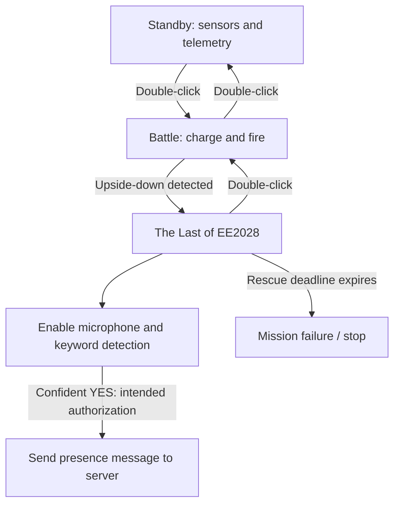
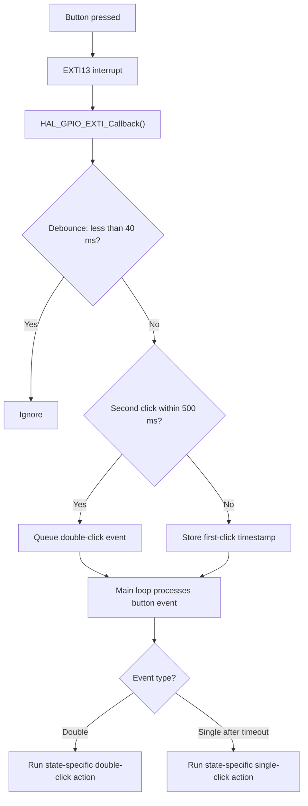
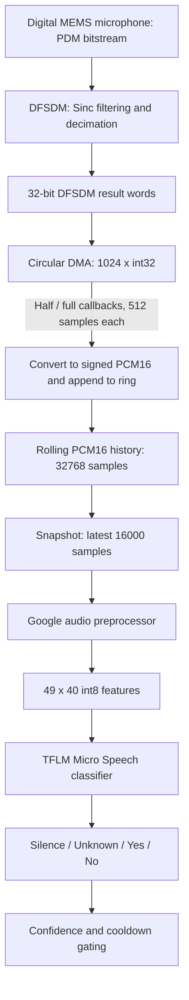
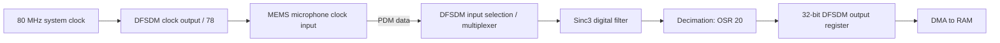
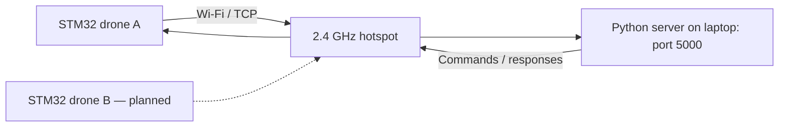

# EE2028 — Zombie-Outbreak Drone System

An STM32-based interactive drone simulation developed for NUS's EE2028. In addition to the course's state-machine, sensing, and interaction requirements, the project explores **Wi-Fi communication** and **on-device keyword recognition** using Google's TensorFlow Lite Micro (TFLM) Micro Speech models.

## Hardware and development environment

| Item | Details |
| --- | --- |
| Development board | ST B-L4S5I-IOT01A Discovery kit (IoT node) |
| MCU | STM32L4S5VIT6, Arm Cortex-M4, up to 80 MHz, 2 MB Flash, 640 KB RAM (distributed across memory regions) |
| Audio | Onboard digital MEMS microphone, PDM output |
| Sensors | Accelerometer, Gyroscope, Magnetometer, Temperature Sensor, Pressure Sensor, Humidity Sensor |
| Connectivity | Onboard Wi-Fi module, driven through ST's ES-WIFI stack over SPI |
| Serial | UART, 115200 baud |

## 1. Scenario and application states

The board represents a drone operating during a fictional zombie-virus outbreak.

| State | Behaviour | Transition / trigger |
| --- | --- | --- |
| `STANDBY_MODE` | Reads environmental and motion sensors every second; transmits telemetry. Flag out if sensor readings exceed thresholds | Double-click the user button to enter Battle Mode. LED alwasy on |
| `BATTLE_MODE` | Simulates a weapon: each single press adds **3 energy**; once energy reaches **5**, the gun fires and consumes 5 energy. The board monitors its orientation. | Double-click to return to Standby; an upside-down condition enters `THE_LAST_OF_EE2028`. LED blinks at 1Hz |
| `THE_LAST_OF_EE2028` | Simulates a drone under attack. LED and warning messages run while the system enables keyword recognition and prepares to contact other drones through a server. | Double-click to clear the emergency and return to Battle; a rescue timeout ends the scenario. LED blinks at 2Hz |

### 1.1 Additional Behaviour: Rescue call

The premise of LAST OF EE2028 is that the drone is surrounded and outnumbered by zombies. Before drone can send a call for rescue, keyword has to be spoken to the drone in order for the call to be sent out. A *"YES"*(the keyword in question) indicates a human-presence. If no human is present, it might be better to leave the drone to be destroyed in order to save human lives.

### 1.2 Application flow



### 1.3 Button behaviour

## Button Interrupt and Click Detection

The STM32 uses GPIO EXTI13 to detect button presses. The
Cortex-M SysTick-based HAL time counter provides timestamps
for debouncing and distinguishing single from double clicks.



## 2. Embedded keyword recognition



### 2.1 Microphone and DFSDM (`microphone.c`)

A **pulse-density-modulated (PDM)** microphone emits a high-frequency sequence of bits. The density of `1` bits over time encodes the audio waveform. The microphone receives a clock generated by the STM32's DFSDM clock-output circuitry. In the tested configuration, the output-clock selection is `DFSDM_CHANNEL_OUTPUT_CLOCK_SYSTEM`, using the system clock as the source, with a divider of 78.
- 78 was choosen so that the microphone produces an approximately 16kHz output  

The **Digital Filter for Sigma-Delta Modulators (DFSDM)** receives the serial bitstream, applies a Sinc3 digital filter to attenuate out-of-band components, and decimates the stream to a much lower sample rate. The DFSDM output is captured in 32-bit result-register words. Software converts the signal into signed PCM16 samples in the rolling audio history.

At the same time, a **multiplexer** selects which external or internal DFSDM input is routed to a channel/filter.

**Measured configuration:**

| Parameter | Value |
| --- | ---: |
| System clock | 80 MHz |
| DFSDM clock-output divider | 78 |
| DFSDM filter | Sinc3 |
| Filter oversampling | 20 |
| Integration oversampling | 1 |
| 16,000-sample transfer | 999 ms measured |
| Approximate measured output rate | 16,016 samples/s |




### 2.2 Circular DMA and rolling audio (`audio_stream.c`)

**Direct Memory Access (DMA)** transfers samples from the DFSDM peripheral into RAM without requiring the CPU to copy each individual result. In **circular mode**, the DMA controller wraps to the beginning of the buffer instead of stopping at the end.

The hardware DMA buffer has 1,024 `int32_t` entries, divided into two 512-sample halves. 
- A half-transfer callback signals that the first half is ready
- A full-transfer callback signals that the second half is ready. 

```text
DMA circular buffer (1024 x int32_t; ~64 ms at 16 kHz)

  indices 0..511               indices 512..1023
┌───────────────────────────┬───────────────────────────┐
│          HALF A           │          HALF B           │
└───────────────────────────┴───────────────────────────┘
              │                           │
       half-transfer IRQ             full-transfer IRQ
              │                           │
              └───────────┬───────────────┘
                          ▼
            Convert DFSDM words to PCM16
                          ▼
           Rolling history: 32768 samples
                          ▼
          Latest 16000-sample snapshot

DMA wraps from index 1023 back to index 0 continuously.
```

The rolling PCM16 buffer stores **32,768 samples** (about 2 seconds). 


### 2.3 Google audio preprocessor (`audio_preprocessor.cpp`)

```text
Audio time ─────────────────────────────────────────────►

Window 1: [────────────── 1000 ms ──────────────]
Window 2:           [────────────── 1000 ms ──────────────]
Window 3:                     [────────────── 1000 ms ──────────────]
          ◄── 750 ms ──► between consecutive window starts
          Overlap between adjacent windows = 250 ms
```

A separate **16,000-sample snapshot** provides stable input for preprocessing every 750ms. The overlap is required so that words are not cut off betweem sample snapshots

Google's **preprocessing model** prepares the data for speech classification. It uses windowing, FFT, spectral-energy calculation, filter banks, spectral subtraction/noise reduction, PCAN and logarithmic scaling. 

| Feature setting | Value |
| --- | ---: |
| Sample rate | 16,000 Hz |
| Frame length | 480 samples (30 ms) |
| Frame stride | 320 samples (20 ms) |
| Number of frames | 49 |
| Frequency channels per frame | 40 |
| Classifier input | 49 × 40 = 1,960 `int8_t` values |

### 2.4 Micro Speech classifier (`ml_inference.cpp`)

The pretrained classifier produces four quantized output scores:

| Index | Label | Interpretation |
| --- | --- | --- |
| 0 | `SILENCE` | Little or no relevant speech activity |
| 1 | `UNKNOWN` | Audio not classified as either target keyword |
| 2 | `YES` | Target keyword “yes” |
| 3 | `NO` | Target keyword “no” |

The largest score determines the argmax prediction.. We normalies the prediction using the output tensor's actual scale `s` and zero point `z`:

\[
\text{real output} = (\text{raw int8 score} - z)\,s
\]

The prototype applies an **80% confidence threshold** and **1.5-second cooldown** to reduce weak and repeated detections respectively. 

It uses four operator types: DepthwiseConv2D, FullyConnected, Reshape and Softmax.


## 3. Wi-Fi communication

The board connects to a **2.4 GHz Wi-Fi** and communicates with a Python server running on a laptop on the same network. The intended next phase is communication between two boards, relayed through that server.

### 3.1 Source files and responsibilities

| File(s) | Role |
| --- | --- |
| `Core/Src/es_wifi.c`, `es_wifi_io.c`, `wifi.c` and associated headers | ST-provided Wi-Fi stack and hardware interface, sourced from the same STM32CubeL4 Wi-Fi/Common package to avoid version mismatches. |
| `es_wifi_conf.h` | Configures Wi-Fi driver options, including SPI operation. |
| `Core/Src/wifi_link.c`, `Core/Inc/wifi_link.h` | Project-specific wrapper that joins the hotspot, manages the laptop connection, sends and receives messages, and attempts reconnection. |
| `Core/Inc/wifi_secrets_example.h` | Template for network settings; safe to commit after removing real credentials. |
| `Core/Inc/wifi_secrets.h` | Local hotspot SSID/password and laptop address; **do not commit**. |
| `server.py` | Laptop-side Python server that accepts board messages and allows sending commands back. |

The wrapper exposes:

```c
int WifiLink_Init(void);  // Join hotspot and connect to laptop; 0 = OK
int WifiLink_Send(const char *msg);  // 0 = OK; reconnect attempts rate-limited to ~5 s
int WifiLink_Receive(char *buf, uint16_t maxlen, uint32_t timeout_ms);
int WifiLink_IsConnected(void);
void Comms_Print(const char *msg);  // UART + laptop when connected
```
`WifiLink_Receive` may block for up to the specified timeout. `Comms_Print` is intended to mirror messages to UART and the connected laptop, subject to the connection state.

### 3.2 SPI and interrupt integration

The Wi-Fi module communicates through SPI and `SPI_INTERFACE_PRIO` is also configured (value 1 in the tested setup). The application uses the appropriate SPI handle in `SPI3_IRQHandler()`:

The Wi-Fi interrupt is dispatched through EXTI line 1. The active `HAL_GPIO_EXTI_Callback()` routes `GPIO_PIN_1` to `SPI_WIFI_ISR()` **before** the separate user-button handling logic. 

The old `Drivers/BSP/Components/es_wifi` copy was identified as incompatible with the selected driver sources and must remain excluded from compilation to avoid duplicate or mismatched definitions.

### 3.3 Laptop server and remote commands

The Python server listens on **TCP port 5000**. In the single-board workflow, it displays messages received from the STM32 and sends operator-entered lines back to the board.



The integrated main-loop design polls for messages approximately every 200 ms, with a 1 ms receive timeout:

| Server command | Intended action |
| --- | --- |
| `s` | Dispatch the same action as a single button click |
| `d` | Dispatch the same action as a double click |
| Other text | Echo or report over UART |

Both physical and remote button commands are routed through a shared `dispatch_click()` mechanism. If speech detection becomes less responsive, the Wi-Fi polling frequency and blocking time should be measured and adjusted.

### 3.4 Running the Wi-Fi demo

1. Copy `Core/Inc/wifi_secrets_example.h` to `Core/Inc/wifi_secrets.h` and set the hotspot SSID, password and laptop IP address.
2. Use a hotspot that supports **2.4 GHz** Wi-Fi.
3. Allow the Python server through Windows Firewall as appropriate for the network profile; avoid unnecessarily exposing the service to untrusted networks.
4. Run `python server.py` on the laptop.
5. Flash the STM32 and check UART output for connection status. If Wi-Fi initialization fails, the integrated application is designed to continue with UART-only operation rather than halt.
6. Test receiving messages from the board and sending `s` / `d` commands from the laptop.

## References and acknowledgements

- Google, **TensorFlow Lite Micro** — runtime, Micro Speech classifier, audio preprocessing and signal kernels. Development repository revision observed: `1f7a33ca`.
- TFLM example sources: `tensorflow/lite/micro/examples/micro_speech/micro_speech_test.cc`, `audio_preprocessor.py` and `evaluate.py`.
- STMicroelectronics, **STM32L4S5 device reference documentation**, STM32L4 HAL and B-L4S5I-IOT01 BSP — RCC, DFSDM, DMA, UART, interrupts, sensors and Wi-Fi interfaces.